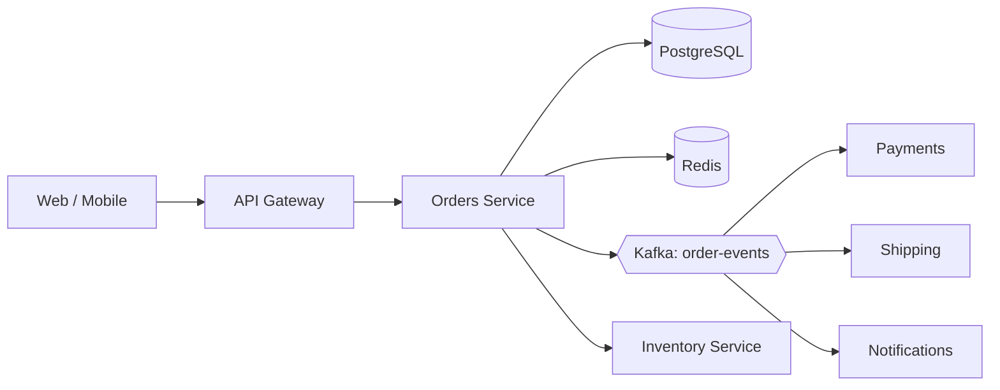

# Orders Service

> Handles order intake, validation, and fulfillment orchestration for the Acme storefront.

 

|                   |                                           |
| ----------------- | ----------------------------------------- |
| **Owner**         | Platform Team (`#platform-team` on Slack) |
| **On-call**       | PagerDuty schedule: `orders-primary`      |
| **Repo**          | `github.com/acme/orders-service`          |
| **Environments**  | `dev`, `staging`, `prod`                  |
| **Last reviewed** | 2026-11-16                                |

---

## Table of Contents

- [Orders Service](#orders-service)
  - [Table of Contents](#table-of-contents)
  - [Overview](#overview)
  - [Architecture](#architecture)
  - [Getting Started](#getting-started)
    - [Prerequisites](#prerequisites)
    - [Local setup](#local-setup)
    - [Running tests](#running-tests)
  - [Configuration](#configuration)
  - [API Reference](#api-reference)
  - [Deployment](#deployment)
  - [Monitoring \& Alerts](#monitoring--alerts)
  - [Runbook](#runbook)
    - [Service is returning 5xx errors](#service-is-returning-5xx-errors)
    - [Orders stuck in `pending`](#orders-stuck-in-pending)
  - [Troubleshooting](#troubleshooting)
  - [Contributing](#contributing)

---

## Overview

The Orders Service receives orders from the web and mobile clients, validates them against inventory and pricing, persists them, and publishes events for downstream systems (payments, shipping, notifications).

**Responsibilities**

- Accept and validate new orders
- Maintain order state (`pending → paid → shipped → delivered / cancelled`)
- Publish order lifecycle events

**Non-responsibilities**

- Payment processing (see `payments-service`)
- Inventory management (see `inventory-service`)

## Architecture



| Component | Technology           | Purpose                         |
| --------- | -------------------- | ------------------------------- |
| API       | Node.js 20 / Express | REST endpoints                  |
| Database  | PostgreSQL 15        | Order storage                   |
| Cache     | Redis 7              | Idempotency keys, price lookups |
| Messaging | Kafka                | Event publishing                |
| Hosting   | Kubernetes (EKS)     | Container orchestration         |

**Dependencies:** `inventory-service` (sync, HTTP), `payments-service` (async, Kafka).

## Getting Started

### Prerequisites

- Node.js 20+
- Docker and Docker Compose
- Access to the `acme` npm registry

### Local setup

```bash
git clone git@github.com:acme/orders-service.git
cd orders-service
cp .env.example .env
docker compose up -d        # starts Postgres, Redis, Kafka
npm install
npm run migrate
npm run dev
```

The service runs at `http://localhost:3000`. Verify with:

```bash
curl http://localhost:3000/health
# {"status":"ok"}
```

### Running tests

```bash
npm test                # unit tests
npm run test:integration
```

## Configuration

All configuration is via environment variables.

| Variable            | Required | Default | Description                      |
| ------------------- | -------- | ------- | -------------------------------- |
| `PORT`              | No       | `3000`  | HTTP port                        |
| `DATABASE_URL`      | Yes      | —       | PostgreSQL connection string     |
| `REDIS_URL`         | Yes      | —       | Redis connection string          |
| `KAFKA_BROKERS`     | Yes      | —       | Comma-separated broker list      |
| `INVENTORY_API_URL` | Yes      | —       | Base URL for inventory-service   |
| `LOG_LEVEL`         | No       | `info`  | `debug`, `info`, `warn`, `error` |

Secrets are stored in AWS Secrets Manager under `orders-service/<env>`.

## API Reference

Full OpenAPI spec: [`docs/openapi.yaml`](docs/openapi.yaml)

| Method  | Endpoint                | Description     |
| ------- | ----------------------- | --------------- |
| `POST`  | `/v1/orders`            | Create an order |
| `GET`   | `/v1/orders/:id`        | Get an order    |
| `PATCH` | `/v1/orders/:id`        | Update an order |
| `POST`  | `/v1/orders/:id/cancel` | Cancel an order |
| `GET`   | `/health`               | Liveness check  |

**Example: create an order**

```bash
curl -X POST https://api.acme.com/v1/orders \
  -H "Authorization: Bearer $TOKEN" \
  -H "Idempotency-Key: 7c9e6679-7425-40de-944b-e07fc1f90ae7" \
  -H "Content-Type: application/json" \
  -d '{"customerId":"cus_123","items":[{"sku":"TSHIRT-M","qty":2}]}'
```

## Deployment

Deployments are automated through GitHub Actions.

| Environment | Trigger         | Approval           |
| ----------- | --------------- | ------------------ |
| `dev`       | Merge to `main` | None               |
| `staging`   | Merge to `main` | None               |
| `prod`      | Tag `v*.*.*`    | Platform Team lead |

**Rollback:**

```bash
kubectl rollout undo deployment/orders-service -n orders
```

## Monitoring & Alerts

- **Dashboard:** Grafana → *Orders Service Overview*
- **Logs:** Datadog, `service:orders-service`
- **Key metrics:** request rate, p95 latency, error rate, Kafka consumer lag

| Alert           | Condition               | Severity |
| --------------- | ----------------------- | -------- |
| High error rate | 5xx > 2% for 5 min      | P1       |
| High latency    | p95 > 800 ms for 10 min | P2       |
| Consumer lag    | lag > 5,000 for 10 min  | P2       |

## Runbook

### Service is returning 5xx errors

1. Check the Grafana dashboard for the start time of the errors.
2. Check recent deployments: `kubectl rollout history deployment/orders-service -n orders`
3. If errors began after a deploy, roll back (see [Deployment](#deployment)).
4. If not, check database health and connection pool saturation.

### Orders stuck in `pending`

1. Confirm `payments-service` is healthy.
2. Check consumer lag on the `payment-events` topic.
3. Re-publish stuck events with `npm run ops:replay -- --status=pending`.

## Troubleshooting

| Symptom                         | Likely cause                           | Fix                                |
| ------------------------------- | -------------------------------------- | ---------------------------------- |
| `ECONNREFUSED` on startup       | Docker services not running            | `docker compose up -d`             |
| `duplicate key` on order create | Reused idempotency key                 | Use a new `Idempotency-Key`        |
| Slow responses                  | Cold Redis cache or DB pool exhaustion | Check pool metrics; scale replicas |

## Contributing

1. Create a branch from `main` (`feature/short-description`).
2. Add tests for any new behavior.
3. Open a PR; at least one Platform Team review is required.
4. Update this README and `docs/openapi.yaml` if behavior changes.

---

*Questions? Ask in `#platform-team` or open an issue in this repo.*
